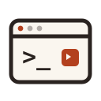

<p align="center"></p>

# Danikuse

[](LICENSE)   

Одна команда, которая даёт AI-агенту контролируемый доступ к вашему браузеру Brave и рабочему столу Windows.

> 🎬 Демо-видео в работе — тред запуска: [x.com/danik13dev/status/2120983521552707945](https://x.com/danik13dev/status/2120983521552707945)

**Скажите своему AI-агенту:** «Поставь Danikuse из этого репозитория: запусти `install.ps1`, прочитай `SKILL.md` и используй `/danikuse` как единственную точку входа для браузера и десктопа».

## Зачем

Браузерные агенты, десктопные агенты, парсеры и тестовые драйверы существуют по отдельности. Danikuse связывает проверенные инструменты в один маршрут с одной моделью безопасности и одним форматом доказательств:

- **Ядро:** [agent-browser](https://github.com/vercel-labs/agent-browser) + [agent-desktop](https://github.com/vercel-labs/agent-desktop), оба работают через уже установленный Brave. Второй Chromium не скачивается.
- **Dev-цикл:** агент открывает сайт, который только что сделал, снимает скриншот и сам смотрит на результат.
- **Чтение веба:** сначала извлечение через agent-browser; Firecrawl без ключа (scrape/search/parse) — только для публичных страниц без состояния.
- **Один JSON-контракт:** каждое действие возвращает `{status, browser, action, screenshot, error, next, durationMs, runDir}`. Нет доказательств — нет «готово».
- **Твой браузер без перезапуска:** расширение Danikuse Bridge управляет живым Brave (вкладки, клики, ввод, загрузка файлов) через локальный хост с токеном. Занимай вкладку, а не плоди новые.
- **Невидимый agent-браузер:** init-script убирает следы автоматизации (проходит [bot.sannysoft.com](https://bot.sannysoft.com/)) — браузер агента выглядит как обычный Brave.
- **Адаптер капчи:** решение reCAPTCHA v2 через CapSolver (`DANIKUSE_CAPSOLVER_KEY`), агент сам вставляет токен на странице.

## Модель безопасности

- **Confirm Mode** (по умолчанию): чтение, навигация и черновики — свободно; отправка, оплата, публикация и удаление — с подтверждением.
- **Autonomous Mode**: только по явному «делай полностью сам», на одну задачу. Оплата, смена паролей и доступов, необратимое удаление — **Hard Stop** в любом режиме.
- Два браузера: лёгкий **Automation Browser** (движок Brave, отдельный профиль, ~10 МБ) по умолчанию и ваш **Personal Brave** только для личных задач, через локальный CDP-порт только на время задачи.
- Прогоны и скриншоты остаются на вашей машине и никогда не попадают в репозиторий.

## Установка (Windows, сертифицированный путь)

```powershell
./install.ps1
node ./bin/danikuse.mjs doctor
npm run benchmark
```

Нужны Node.js >= 18 и Brave. Размер установки обоих движков — около 156 МБ при бюджете проекта 500 МБ; профиль автоматизации стартует примерно с 10 МБ. macOS/Linux в v0.1 не сертифицированы.

## Работает ли это

Это измеряемое утверждение, а не лозунг: `npm run benchmark` прогоняет пять задач (заполнение и отправка формы, структурированное извлечение, скриншот в dev-цикле, действие в десктопном приложении, черновик в Personal Brave без отправки) на локальных фикстурах и пишет отчёт с таймингом. v0.1 проходит при результате 4 из 5 и лучше.

## Структура

- `bin/danikuse.mjs` — CLI, через который идут все маршруты
- `SKILL.md` — роутер-скилл `/danikuse` для любого агентного окружения
- `AGENTS.md` — правила проекта, `GLOSSARY.md` — фиксированный словарь
- `scripts/benchmark.mjs` — бенчмарк из пяти задач

Опциональные слои с отдельными решениями, сознательно вне ядра: Skyvern (AGPL, только внешний HTTP), сервисы решения капчи, платный Firecrawl.

Лицензия: Apache-2.0. English version: [README.md](README.md).
